# Atelier — Observabilité avec Spring Boot Actuator

## Objectif

Documenter les vérifications effectuées dans le cadre de l'atelier **Architecture Web Distribuée — Observabilité avec Spring Boot Actuator** : surveillance de la santé des microservices, observation d'une panne MySQL, consultation des métriques, puis endpoints de santé et d'information pour Meeting (Node.js) et Notification (Python).

Les captures ci-dessous proviennent des tests réalisés et sont organisées selon les parties du support de TP. Les noms des images sont conservés dans le dossier `assets/` de ce rendu.

## 1. Santé de Job et intégration avec Eureka

### 1.1 — Job : état de santé `UP` avec MySQL disponible

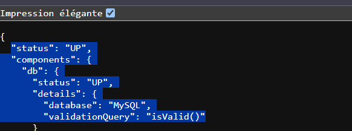

L'endpoint `/actuator/health` du service Job affiche `status: UP`. Le composant `db` est également `UP` et indique une base **MySQL** accessible.

### 1.2 — Job : état de santé `DOWN` après arrêt de MySQL

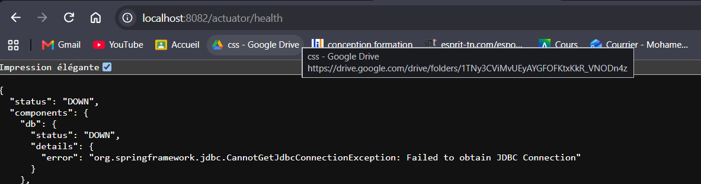

Après l'arrêt de MySQL, `/actuator/health` du service Job retourne `DOWN` et le composant `db` signale un échec de connexion JDBC. Le service ne peut donc plus être considéré comme sain, même si son processus continue de fonctionner.

### 1.3 — Eureka : Job signalé `DOWN`

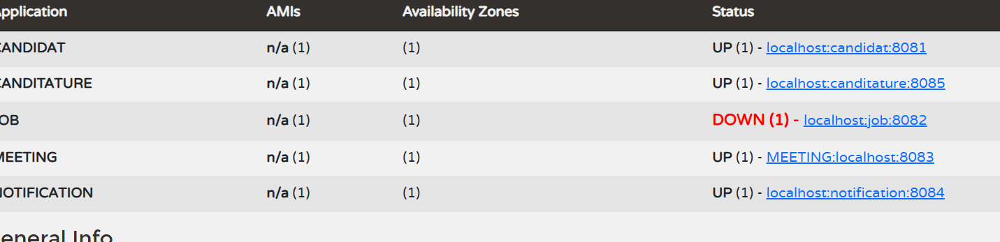

Le tableau de bord Eureka indique `DOWN` pour **JOB**, tandis que les autres microservices apparaissent `UP`. Cette capture illustre la propagation de l'état de santé vers le registre de découverte.

### 1.4 — Eureka : microservices enregistrés et `UP`

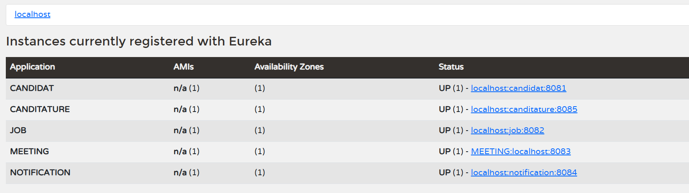

Le dashboard présente les microservices **CANDIDAT**, **CANDIDATURE**, **JOB**, **MEETING** et **NOTIFICATION** avec le statut `UP`. Cette capture montre un état de fonctionnement normal du système.

## 2. Métriques de Spring Boot Actuator

### 2.1 — Liste des métriques disponibles

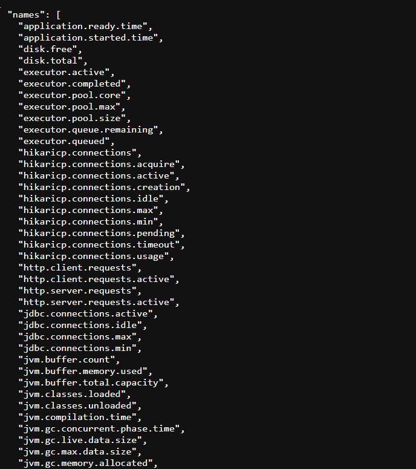

L'endpoint `/actuator/metrics` répertorie les métriques exposées, notamment celles liées à la JVM et aux requêtes HTTP. Il permet d'identifier les indicateurs consultables par nom.

### 2.2 — Métriques des requêtes HTTP ayant le statut `200`

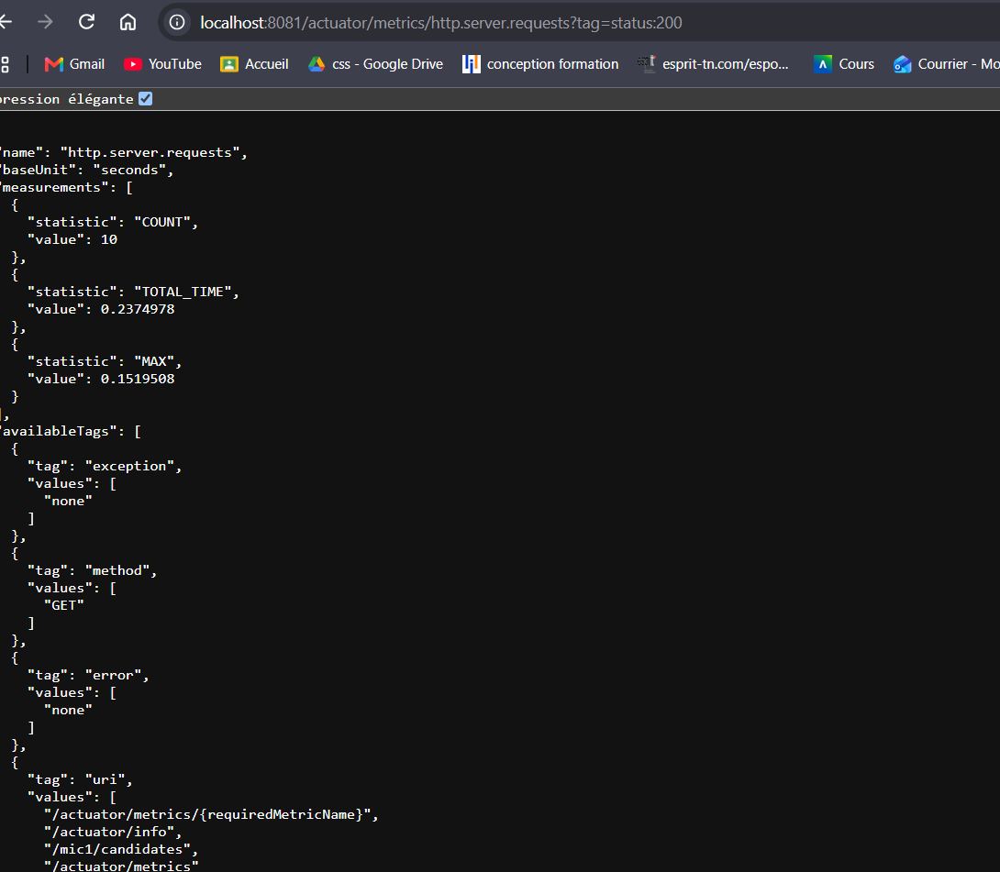

L'endpoint `/actuator/metrics/http.server.requests?tag=status:200` filtre les requêtes HTTP réussies de statut **200**. Les résultats visibles sur cette capture indiquent :

| Mesure | Valeur observée | Interprétation |
|---|---:|---|
| `COUNT` | `10` | 10 requêtes HTTP correspondant au filtre |
| `TOTAL_TIME` | `0.2374978 s` | Durée cumulée des requêtes |
| `MAX` | `0.1519508 s` | Durée de la requête la plus lente, soit environ 152 ms |

Ces valeurs correspondent à l'instant de la capture et peuvent évoluer avec de nouvelles requêtes.

## 3. Meeting — Node.js / Express

### 3.1 — Endpoint `/health` de Meeting

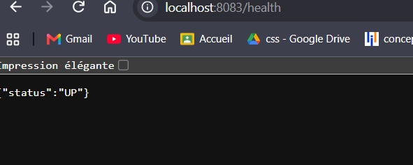

La route `GET http://localhost:8083/health` renvoie `{"status":"UP"}` : le service Meeting expose bien un point de contrôle de santé.

### 3.2 — Endpoint `/info` de Meeting

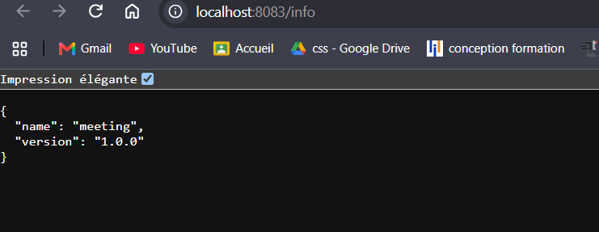

La route `GET http://localhost:8083/info` fournit les informations du microservice : `name: meeting` et `version: 1.0.0`.

### 3.3 — Nouvelle vérification des informations Meeting

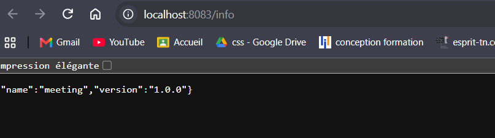

Une seconde capture confirme que l'endpoint `/info` répond avec le nom `meeting` et la version `1.0.0`.

## 4. Notification — Python / FastAPI

### 4.1 — Endpoint `/health` de Notification

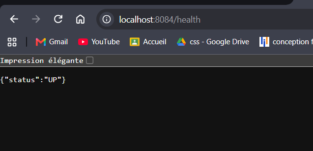

La route `GET http://localhost:8084/health` renvoie `{"status":"UP"}`. Le service Notification expose son état de santé.

### 4.2 — Endpoint `/info` de Notification

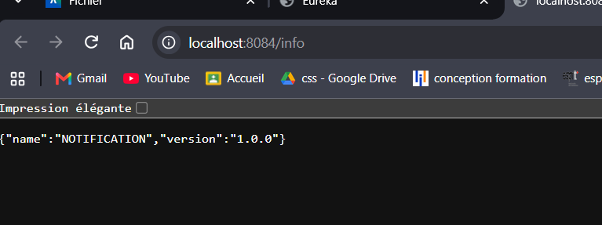

La route `GET http://localhost:8084/info` renvoie le nom `NOTIFICATION` et la version `1.0.0`.

### 4.3 — Confirmation de l'endpoint `/info` de Notification

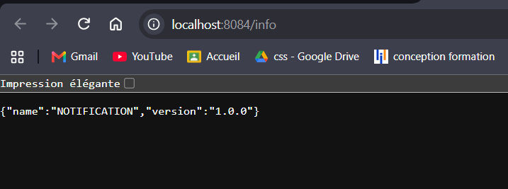

La seconde capture de `/info` confirme la disponibilité des métadonnées du service Notification.

## 5. Vérification de l'enregistrement dans Eureka

### 5.1 — Registre Eureka : informations de l'instance Notification

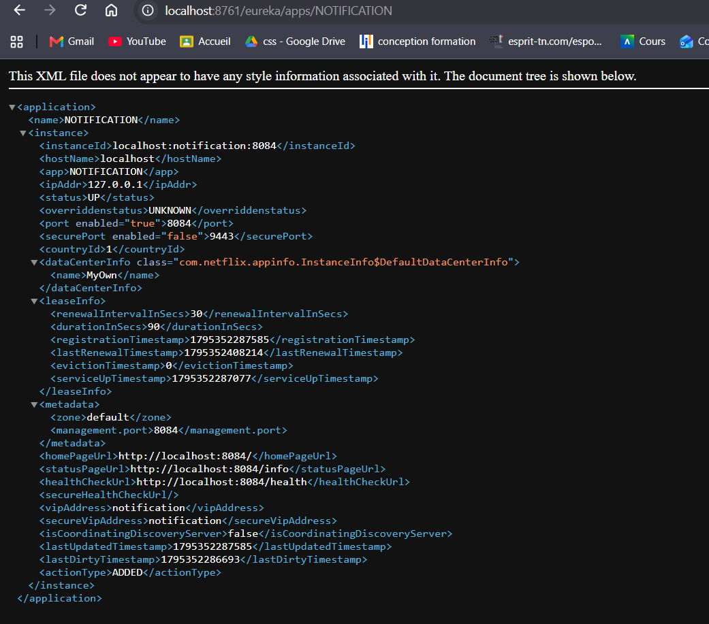

La réponse du registre Eureka affichée au format XML permet de consulter les informations enregistrées pour l'instance Notification, notamment les URL associées à son enregistrement. Cette vérification complète les tests directs des endpoints `/health` et `/info`.

## 6. Bilan

Les captures fournies permettent de constater :

- Le bon fonctionnement du contrôle de santé Spring Boot Actuator lorsque MySQL est disponible.
- Le passage de Job à `DOWN` lorsque la connexion MySQL échoue, également visible dans Eureka.
- L'exposition des métriques Actuator et le filtrage des requêtes HTTP par code de statut.
- La disponibilité des endpoints `/health` et `/info` pour Meeting et Notification.
- La présence des instances dans le registre Eureka et la consultation des informations d'enregistrement de Notification.

> **Périmètre des preuves :** les captures documentent les résultats affichés. Elles ne prouvent pas, à elles seules, l'ensemble du code source, la configuration de chaque client Eureka, ni les étapes du TP non photographiées (par exemple le changement dynamique des niveaux de logs).

---

**Référence :** *Atelier — Observabilité avec Spring Boot Actuator*, Architecture Web Distribuée, année universitaire 2026–2027.
